# InternLink Database Architecture Audit Report

**Project:** InternLink - University Internship Management Platform  
**Date:** 2026-11-09  
**Auditor:** Senior PostgreSQL & Sequelize Engineer  
**Database:** PostgreSQL 18 (ai_internship)  
**ORM:** Sequelize 6  
**Status:** READ-ONLY INVESTIGATION  

---

## Executive Summary

This report provides a comprehensive audit of the existing Sequelize models, associations, and database architecture for the InternLink platform. The audit reveals **critical data type inconsistencies** that must be resolved before database schema creation, including a fundamental UUID/BIGINT mismatch between User and StudentProfile relationships.

### Key Findings Summary

- **CRITICAL:** UUID/BIGINT type mismatch between User.id (UUID) and StudentProfile.id (BIGINT) 
- **CRITICAL:** StudentSkill and StudentInterest use BIGINT student_id but should reference StudentProfile.id (BIGINT), not User.id (UUID)
- **CRITICAL:** TeamMember.student_id is UUID (uncommitted change) but association references User.id (UUID) - this is correct but conflicts with StudentProfile pattern
- **HIGH:** All associations use `constraints: false`, disabling database-level referential integrity
- **HIGH:** WeeklyLogbook contains ambiguous virtual field aliases (team_id vs project_team_id)
- **MEDIUM:** Missing foreign key indexes on many join tables
- **MEDIUM:** Several models use VIRTUAL fields without clear database persistence strategy
- **LOW:** No paranoid/soft-delete configuration on any models

### Risk Assessment

| Severity | Count | Impact |
|----------|-------|--------|
| CRITICAL | 3 | Database integrity violations, potential runtime errors |
| HIGH | 2 | Data inconsistency risks, missing referential integrity |
| MEDIUM | 4 | Performance issues, unclear data persistence |
| LOW | 1 | Missing soft-delete functionality |

---

## Task 1: Complete Model Inventory

### 1. User Model
**Table:** `accounts_user`  
**Primary Key:** `id` (UUID, auto-generated)  
**Timestamps:** Yes (created_at, updated_at)

| Field | Type | Nullable | Default | Unique | Notes |
|-------|------|----------|---------|--------|-------|
| id | UUID | No | UUIDV4 | Yes | Primary key |
| email | STRING | No | - | Yes | User email |
| username | STRING | Yes | - | Yes | Username |
| password | STRING | No | - | No | Hashed password |
| first_name | STRING | No | '' | No | First name |
| last_name | STRING | No | '' | No | Last name |
| role | STRING | No | 'student' | No | Role (student, admin, advisor, etc.) |
| phone_number | STRING | No | '' | No | Phone number |
| department | STRING | No | '' | No | Department |
| university_name | STRING | No | '' | No | University name |
| staff_id_number | STRING | No | '' | No | Staff ID |
| is_approved | BOOLEAN | No | true | No | Account approval status |
| is_active | BOOLEAN | No | true | No | Account active status |
| is_email_verified | BOOLEAN | No | false | No | Email verification |
| is_staff | BOOLEAN | No | false | No | Staff flag |
| is_superuser | BOOLEAN | No | false | No | Superuser flag |
| profile_photo | STRING | Yes | - | No | Profile photo path |
| last_login | DATE | Yes | - | No | Last login timestamp |
| date_joined | DATE | No | NOW | No | Registration date |
| created_at | DATE | No | NOW | No | Creation timestamp |
| updated_at | DATE | No | NOW | No | Update timestamp |

**Custom Methods:**
- `getFullName()` - Returns full name or username/email

---

### 2. StudentProfile Model
**Table:** `student_profiles_studentprofile`  
**Primary Key:** `id` (BIGINT, auto-increment)  
**Timestamps:** Yes (created_at, updated_at)

| Field | Type | Nullable | Default | Unique | Notes |
|-------|------|----------|---------|--------|-------|
| id | BIGINT | No | AUTO_INCREMENT | Yes | Primary key |
| user_id | UUID | No | - | No | **FK to User.id** |
| phone | STRING | No | '' | No | Phone number |
| country | STRING | No | 'Ethiopia' | No | Country |
| city | STRING | No | 'Addis Ababa' | No | City |
| date_of_birth | DATEONLY | Yes | - | No | Date of birth |
| bio | TEXT | No | '' | No | Bio/description |
| education_level | STRING | No | 'Undergraduate' | No | Education level |
| current_year | STRING | No | '4' | No | Current academic year |
| field_of_study | STRING | No | 'Software Engineering' | No | Field of study |
| university | STRING | No | 'Addis Ababa University' | No | University |
| student_id_number | STRING | No | '' | No | Student ID number |
| gpa | FLOAT | Yes | - | No | GPA |
| experience | TEXT | No | '' | No | Work experience |
| internship_type | STRING | No | 'any' | No | Internship type preference |
| work_type | STRING | No | 'either' | No | Work type preference |
| compensation_preference | STRING | No | 'either' | No | Compensation preference |
| minimum_compensation | FLOAT | Yes | - | No | Min compensation |
| maximum_compensation | FLOAT | Yes | - | No | Max compensation |
| compensation_currency | STRING | No | 'ETB' | No | Currency |
| preferred_locations | JSONB | No | [] | No | Preferred locations (array) |
| willing_to_relocate | BOOLEAN | No | false | No | Relocation willingness |
| preferred_industries | JSONB | No | [] | No | Preferred industries (array) |
| preferred_roles | JSONB | No | [] | No | Preferred roles (array) |
| internship_duration_min_weeks | INTEGER | Yes | - | No | Min duration (weeks) |
| internship_duration_max_weeks | INTEGER | Yes | - | No | Max duration (weeks) |
| availability_start | DATEONLY | Yes | - | No | Availability start |
| availability_end | DATEONLY | Yes | - | No | Availability end |
| availability_immediately | BOOLEAN | No | false | No | Available immediately |
| cv | STRING | Yes | - | No | CV file path |
| resume | STRING | Yes | - | No | Resume file path |
| resume_parsed | BOOLEAN | No | false | No | Resume parsing status |
| resume_parsed_at | DATE | Yes | - | No | Resume parsed timestamp |
| created_at | DATE | No | NOW | No | Creation timestamp |
| updated_at | DATE | No | NOW | No | Update timestamp |

**Custom Getters:**
- `preferred_locations` - JSONB getter with string fallback
- `preferred_industries` - JSONB getter with string fallback
- `preferred_roles` - JSONB getter with string fallback

---

### 3. Skill Model
**Table:** `internships_skill`  
**Primary Key:** `id` (BIGINT, auto-increment)  
**Timestamps:** Yes (created_at, updated_at)

| Field | Type | Nullable | Default | Unique | Notes |
|-------|------|----------|---------|--------|-------|
| id | BIGINT | No | AUTO_INCREMENT | Yes | Primary key |
| name | STRING | No | - | Yes | Skill name |
| category | STRING | No | 'General' | No | Skill category |
| description | TEXT | No | '' | No | Description |
| is_active | BOOLEAN | No | true | No | Active status |
| created_at | DATE | No | NOW | No | Creation timestamp |
| updated_at | DATE | No | NOW | No | Update timestamp |

---

### 4. StudentSkill Model (Join Table)
**Table:** `student_profiles_studentskill`  
**Primary Key:** `id` (BIGINT, auto-increment)  
**Timestamps:** Yes (created_at, updated_at)

| Field | Type | Nullable | Default | Unique | Notes |
|-------|------|----------|---------|--------|-------|
| id | BIGINT | No | AUTO_INCREMENT | Yes | Primary key |
| student_id | BIGINT | No | - | No | **FK to StudentProfile.id** |
| skill_id | BIGINT | No | - | No | **FK to Skill.id** |
| proficiency | STRING | No | 'intermediate' | No | Proficiency level |
| source | STRING | No | 'profile' | No | Source of skill |
| created_at | DATE | No | NOW | No | Creation timestamp |
| updated_at | DATE | No | NOW | No | Update timestamp |

---

### 5. CareerInterest Model
**Table:** `student_profiles_careerinterest`  
**Primary Key:** `id` (BIGINT, auto-increment)  
**Timestamps:** Yes (created_at, updated_at)

| Field | Type | Nullable | Default | Unique | Notes |
|-------|------|----------|---------|--------|-------|
| id | BIGINT | No | AUTO_INCREMENT | Yes | Primary key |
| name | STRING | No | - | Yes | Interest name |
| description | TEXT | No | '' | No | Description |
| is_active | BOOLEAN | No | true | No | Active status |
| created_at | DATE | No | NOW | No | Creation timestamp |
| updated_at | DATE | No | NOW | No | Update timestamp |

---

### 6. StudentInterest Model (Join Table)
**Table:** `student_profiles_studentinterest`  
**Primary Key:** `id` (BIGINT, auto-increment)  
**Timestamps:** Yes (created_at, updated_at)

| Field | Type | Nullable | Default | Unique | Notes |
|-------|------|----------|---------|--------|-------|
| id | BIGINT | No | AUTO_INCREMENT | Yes | Primary key |
| student_id | BIGINT | No | - | No | **FK to StudentProfile.id** |
| interest_id | BIGINT | No | - | No | **FK to CareerInterest.id** |
| created_at | DATE | No | NOW | No | Creation timestamp |
| updated_at | DATE | No | NOW | No | Update timestamp |

---

### 7. CV Model
**Table:** `student_profiles_cv`  
**Primary Key:** `id` (BIGINT, auto-increment)  
**Timestamps:** Yes (created_at, updated_at)

| Field | Type | Nullable | Default | Unique | Notes |
|-------|------|----------|---------|--------|-------|
| id | BIGINT | No | AUTO_INCREMENT | Yes | Primary key |
| student_id | UUID | No | - | No | **FK to User.id** |
| file | STRING | No | - | No | File path |
| processing_status | STRING | No | 'PENDING' | No | Processing status |
| processing_error | TEXT | No | '' | No | Error message |
| extracted_text | TEXT | No | '' | No | Extracted text |
| extracted_skills | JSONB | No | [] | No | Extracted skills |
| extracted_education | JSONB | No | [] | No | Extracted education |
| extracted_experience | JSONB | No | [] | No | Extracted experience |
| extracted_projects | JSONB | No | [] | No | Extracted projects |
| extracted_certifications | JSONB | No | [] | No | Extracted certifications |
| extracted_languages | JSONB | No | [] | No | Extracted languages |
| extracted_experience_years | FLOAT | No | 0 | No | Experience years |
| processed_at | DATE | Yes | - | No | Processed timestamp |
| created_at | DATE | No | NOW | No | Creation timestamp |
| updated_at | DATE | No | NOW | No | Update timestamp |

**Virtual Fields:**
- `uploaded_at` - Alias for created_at
- `extracted_data` - Aggregates extracted fields

---

### 8. Internship Model
**Table:** `internships_internship`  
**Primary Key:** `id` (BIGINT, auto-increment)  
**Timestamps:** Yes (created_at, updated_at)

| Field | Type | Nullable | Default | Unique | Notes |
|-------|------|----------|---------|--------|-------|
| id | BIGINT | No | AUTO_INCREMENT | Yes | Primary key |
| title | STRING | No | - | No | Internship title |
| organization_name | STRING | No | - | No | Organization name |
| description | TEXT | No | - | No | Description |
| category | STRING | No | 'Software Engineering' | No | Category |
| country | STRING | No | 'Ethiopia' | No | Country |
| city | STRING | No | 'Addis Ababa' | No | City |
| location_text | STRING | No | '' | No | Location text |
| internship_type | STRING | No | 'onsite' | No | Type (onsite, remote, hybrid) |
| work_type | STRING | No | 'full_time' | No | Work type |
| work_mode | STRING | No | 'onsite' | No | Work mode |
| compensation_type | STRING | No | 'paid' | No | Compensation type |
| minimum_compensation | FLOAT | Yes | - | No | Min compensation |
| maximum_compensation | FLOAT | Yes | - | No | Max compensation |
| compensation_currency | STRING | No | 'ETB' | No | Currency |
| compensation_period | STRING | No | 'monthly' | No | Period |
| preferred_skills | JSONB | No | [] | No | Preferred skills |
| duration_min_weeks | INTEGER | No | 8 | No | Min duration |
| duration_max_weeks | INTEGER | No | 16 | No | Max duration |
| application_url | STRING | No | '' | No | Application URL |
| source_id | BIGINT | Yes | - | No | Source ID |
| source_url | STRING | No | '' | No | Source URL |
| external_id | STRING | No | '' | No | External ID |
| posted_at | DATE | No | NOW | No | Posted date |
| application_deadline | DATE | Yes | - | No | Deadline |
| is_verified | BOOLEAN | No | true | No | Verified status |
| is_published | BOOLEAN | No | true | No | Published status |
| needs_review | BOOLEAN | No | false | No | Needs review |
| status | STRING | No | 'active' | No | Status |
| rejection_reason | TEXT | No | '' | No | Rejection reason |
| embedding_status | STRING | No | 'ready' | No | Embedding status |
| content_hash | STRING | No | '' | No | Content hash |
| required_education | STRING | No | 'Bachelor' | No | Required education |
| required_experience | STRING | No | '0-1 years' | No | Required experience |
| skills_review | JSONB | No | {} | No | Skills review |
| url_validation | JSONB | No | {} | No | URL validation |
| created_at | DATE | No | NOW | No | Creation timestamp |
| updated_at | DATE | No | NOW | No | Update timestamp |

**Virtual Fields:**
- `is_expired` - Computed from application_deadline
- `required_skills` - Extracted from preferred_skills or skills association

---

### 9. InternshipSkillJoin Model (Join Table)
**Table:** `internships_internship_required_skills`  
**Primary Key:** `id` (BIGINT, auto-increment)  
**Timestamps:** No

| Field | Type | Nullable | Default | Unique | Notes |
|-------|------|----------|---------|--------|-------|
| id | BIGINT | No | AUTO_INCREMENT | Yes | Primary key |
| internship_id | BIGINT | No | - | No | **FK to Internship.id** |
| skill_id | BIGINT | No | - | No | **FK to Skill.id** |

---

### 10. SavedInternship Model
**Table:** `internships_savedinternship`  
**Primary Key:** `id` (BIGINT, auto-increment)  
**Timestamps:** Yes (created_at, updated_at)

| Field | Type | Nullable | Default | Unique | Notes |
|-------|------|----------|---------|--------|-------|
| id | BIGINT | No | AUTO_INCREMENT | Yes | Primary key |
| student_id | UUID | No | - | No | **FK to User.id** |
| internship_id | BIGINT | No | - | No | **FK to Internship.id** |
| created_at | DATE | No | NOW | No | Creation timestamp |
| updated_at | DATE | No | NOW | No | Update timestamp |

---

### 11. InternshipApplication Model
**Table:** `internships_internshipapplication`  
**Primary Key:** `id` (BIGINT, auto-increment)  
**Timestamps:** Yes (created_at, updated_at)

| Field | Type | Nullable | Default | Unique | Notes |
|-------|------|----------|---------|--------|-------|
| id | BIGINT | No | AUTO_INCREMENT | Yes | Primary key |
| student_id | UUID | No | - | No | **FK to User.id** |
| internship_id | BIGINT | No | - | No | **FK to Internship.id** |
| status | STRING | No | 'applied' | No | Application status |
| notes | TEXT | No | '' | No | Cover letter/notes |
| created_at | DATE | No | NOW | No | Creation timestamp |
| updated_at | DATE | No | NOW | No | Update timestamp |

---

### 12. Recommendation Model
**Table:** `recommendations_recommendation`  
**Primary Key:** `id` (BIGINT, auto-increment)  
**Timestamps:** Yes (created_at, updated_at)

| Field | Type | Nullable | Default | Unique | Notes |
|-------|------|----------|---------|--------|-------|
| id | BIGINT | No | AUTO_INCREMENT | Yes | Primary key |
| student_id | UUID | No | - | No | **FK to User.id** |
| internship_id | BIGINT | No | - | No | **FK to Internship.id** |
| overall_score | FLOAT | No | 0 | No | Overall match score |
| semantic_score | FLOAT | No | 0 | No | Semantic score |
| skill_score | FLOAT | No | 0 | No | Skill score |
| preference_score | FLOAT | No | 0 | No | Preference score |
| location_score | FLOAT | No | 0 | No | Location score |
| salary_score | FLOAT | No | 0 | No | Salary score |
| explanation | JSONB | No | [] | No | Explanation bullets |
| status | STRING | No | 'active' | No | Status |
| viewed_at | DATE | Yes | - | No | Viewed timestamp |
| saved_at | DATE | Yes | - | No | Saved timestamp |
| applied_at | DATE | Yes | - | No | Applied timestamp |
| ignored_at | DATE | Yes | - | No | Ignored timestamp |
| created_at | DATE | No | NOW | No | Creation timestamp |
| updated_at | DATE | No | NOW | No | Update timestamp |

---

### 13. ProjectTeam Model
**Table:** `projects_projectteam`  
**Primary Key:** `id` (UUID, auto-generated)  
**Timestamps:** Yes (created_at, updated_at)

| Field | Type | Nullable | Default | Unique | Notes |
|-------|------|----------|---------|--------|-------|
| id | UUID | No | UUIDV4 | Yes | Primary key |
| team_name | STRING | No | - | No | Team name |
| project_title | STRING | No | - | No | Project title |
| cohort_id | UUID | Yes | - | No | Cohort ID |
| assigned_advisor_id | UUID | Yes | - | No | **FK to User.id** |
| srs_status | STRING | No | 'DRAFT' | No | SRS status |
| srs_document | STRING | Yes | - | No | SRS document path |
| srs_feedback | TEXT | No | '' | No | SRS feedback |
| srs_revision_deadline | DATE | Yes | - | No | SRS deadline |
| channels_active | BOOLEAN | No | true | No | Channels active |
| created_at | DATE | No | NOW | No | Creation timestamp |
| updated_at | DATE | No | NOW | No | Update timestamp |

---

### 14. TeamMember Model
**Table:** `projects_teammember`  
**Primary Key:** `id` (UUID, auto-generated)  
**Timestamps:** Yes (created_at, updated_at)

| Field | Type | Nullable | Default | Unique | Notes |
|-------|------|----------|---------|--------|-------|
| id | UUID | No | UUIDV4 | Yes | Primary key |
| team_id | UUID | No | - | No | **FK to ProjectTeam.id** |
| student_id | UUID | No | - | No | **FK to User.id** (UNCOMMITTED: changed from BIGINT) |
| is_leader | BOOLEAN | No | false | No | Leader flag |
| assigned_role | STRING | No | 'Full Stack Engineer' | No | Assigned role |
| created_at | DATE | No | NOW | No | Creation timestamp |
| updated_at | DATE | No | NOW | No | Update timestamp |

**Virtual Fields:**
- `primary_stack` - Returns 'React / Node.js'

---

### 15. WeeklyLogbook Model
**Table:** `projects_weeklylogbook`  
**Primary Key:** `id` (UUID, auto-generated)  
**Timestamps:** Yes (created_at, updated_at)

| Field | Type | Nullable | Default | Unique | Notes |
|-------|------|----------|---------|--------|-------|
| id | UUID | No | UUIDV4 | Yes | Primary key |
| project_team_id | UUID | Yes | - | No | **FK to ProjectTeam.id** |
| student_id | UUID | No | - | No | **FK to User.id** |
| academic_advisor_id | UUID | Yes | - | No | **FK to User.id** |
| company_mentor_id | UUID | Yes | - | No | **FK to User.id** |
| week_number | INTEGER | No | - | No | Week number |
| tasks_planned | TEXT | No | '' | No | Planned tasks |
| tasks_executed | TEXT | No | '' | No | Executed tasks |
| challenges_faced | TEXT | No | '' | No | Challenges |
| git_commit_urls | JSONB | No | [] | No | Git commit URLs |
| similarity_score | FLOAT | No | 0.0 | No | Plagiarism score |
| is_flagged | BOOLEAN | No | false | No | Flagged for plagiarism |
| matched_snippet | TEXT | No | '' | No | Matched snippet |
| advisor_approved | BOOLEAN | No | false | No | Advisor approval |
| advisor_feedback | TEXT | No | '' | No | Advisor feedback |
| submitted_at | DATE | No | NOW | No | Submitted timestamp |
| created_at | DATE | No | NOW | No | Creation timestamp |
| updated_at | DATE | No | NOW | No | Update timestamp |

**Virtual Fields:**
- `team_id` - Alias for project_team_id (getter/setter)
- `content` - Alias for tasks_executed (getter/setter)
- `tasks_completed` - Alias for tasks_executed (getter/setter)
- `blockers` - Alias for challenges_faced (getter/setter)
- `status` - Returns 'APPROVED' or 'SUBMITTED' based on advisor_approved

---

### 16. ProjectTeamMessage Model
**Table:** `projects_projectteammessage`  
**Primary Key:** `id` (UUID, auto-generated)  
**Timestamps:** Yes (created_at, updated_at)

| Field | Type | Nullable | Default | Unique | Notes |
|-------|------|----------|---------|--------|-------|
| id | UUID | No | UUIDV4 | Yes | Primary key |
| team_id | UUID | No | - | No | **FK to ProjectTeam.id** |
| sender_id | UUID | No | - | No | **FK to User.id** |
| message_type | STRING | No | 'GENERAL' | No | Message type |
| message | TEXT | No | - | No | Message content |
| created_at | DATE | No | NOW | No | Creation timestamp |
| updated_at | DATE | No | NOW | No | Update timestamp |

**Virtual Fields:**
- `content` - Alias for message

---

### 17. CampusLogistics Model
**Table:** `logistics_campuslogistics`  
**Primary Key:** `id` (UUID, auto-generated)  
**Timestamps:** Yes (created_at, updated_at)

| Field | Type | Nullable | Default | Unique | Notes |
|-------|------|----------|---------|--------|-------|
| id | UUID | No | UUIDV4 | Yes | Primary key |
| student_id | UUID | No | - | No | **FK to User.id** |
| dean_approved | BOOLEAN | No | false | No | Dean approval |
| dean_signature_hash | STRING | No | '' | No | Dean signature hash |
| dean_signed_by_id | UUID | Yes | - | No | **FK to User.id** |
| dean_signed_at | DATE | Yes | - | No | Dean signed timestamp |
| meal_card_number | STRING | No | '' | No | Meal card number |
| meal_card_active | BOOLEAN | No | false | No | Meal card active |
| meal_card_issued_at | DATE | Yes | - | No | Meal card issued |
| meal_card_issued_by_id | UUID | Yes | - | No | **FK to User.id** |
| student_union_signature_hash | STRING | No | '' | No | Student union signature |
| student_union_qr_code | TEXT | No | '' | No | QR code |
| dorm_block | STRING | No | 'Block A' | No | Dorm block |
| dorm_room | STRING | No | '101' | No | Dorm room |
| dorm_bed_number | STRING | No | 'Bed 1' | No | Bed number |
| dorm_status | STRING | No | 'UNASSIGNED' | No | Dorm status |
| key_issued | BOOLEAN | No | false | No | Key issued |
| key_issued_at | DATE | Yes | - | No | Key issued timestamp |
| key_issued_by_id | UUID | Yes | - | No | **FK to User.id** |
| valid_from | DATEONLY | Yes | - | No | Valid from |
| valid_until | DATEONLY | Yes | - | No | Valid until |
| cleared_at_exit | BOOLEAN | No | false | No | Cleared at exit |
| created_at | DATE | No | NOW | No | Creation timestamp |
| updated_at | DATE | No | NOW | No | Update timestamp |

---

### 18. Notification Model
**Table:** `notifications_notification`  
**Primary Key:** `id` (UUID, auto-generated)  
**Timestamps:** Yes (created_at only, no updated_at)

| Field | Type | Nullable | Default | Unique | Notes |
|-------|------|----------|---------|--------|-------|
| id | UUID | No | UUIDV4 | Yes | Primary key |
| recipient_id | UUID | No | - | No | **FK to User.id** |
| actor_id | UUID | Yes | - | No | **FK to User.id** |
| title | STRING | No | - | No | Notification title |
| message | TEXT | No | - | No | Notification message |
| notification_type | STRING | No | 'INFO' | No | Type |
| link | STRING | Yes | - | No | Link URL |
| is_read | BOOLEAN | No | false | No | Read status |
| metadata | JSONB | No | {} | No | Additional metadata |
| created_at | DATE | No | NOW | No | Creation timestamp |

---

### 19. Company Model
**Table:** `companies_company`  
**Primary Key:** `id` (BIGINT, auto-increment)  
**Timestamps:** Yes (created_at, updated_at)

| Field | Type | Nullable | Default | Unique | Notes |
|-------|------|----------|---------|--------|-------|
| id | BIGINT | No | AUTO_INCREMENT | Yes | Primary key |
| name | STRING | No | - | No | Company name |
| website | STRING | No | '' | No | Website URL |
| industry | STRING | No | 'Information Technology' | No | Industry |
| country | STRING | No | 'Ethiopia' | No | Country |
| created_at | DATE | No | NOW | No | Creation timestamp |
| updated_at | DATE | No | NOW | No | Update timestamp |

**Virtual Fields:**
- `description` - Returns empty string
- `city` - Returns 'Addis Ababa'
- `is_verified` - Returns true

---

### 20. DataSource Model
**Table:** `data_sources_datasource`  
**Primary Key:** `id` (BIGINT, auto-increment)  
**Timestamps:** Yes (created_at, updated_at)

| Field | Type | Nullable | Default | Unique | Notes |
|-------|------|----------|---------|--------|-------|
| id | BIGINT | No | AUTO_INCREMENT | Yes | Primary key |
| name | STRING | No | - | No | Source name |
| base_url | STRING | No | '' | No | Base URL |
| type | STRING | No | 'api' | No | Source type |
| description | TEXT | No | '' | No | Description |
| is_active | BOOLEAN | No | true | No | Active status |
| config | JSONB | No | {} | No | Configuration |
| last_synced_at | DATE | Yes | - | No | Last sync timestamp |
| created_at | DATE | No | NOW | No | Creation timestamp |
| updated_at | DATE | No | NOW | No | Update timestamp |

**Virtual Fields:**
- `url` - Alias for base_url
- `adapter_type` - Alias for type
- `status` - Returns 'healthy' or 'inactive'
- `last_sync_at` - Alias for last_synced_at

---

### 21. StudentActivityLog Model
**Table:** `administration_studentactivitylog`  
**Primary Key:** `id` (BIGINT, auto-increment)  
**Timestamps:** Yes (created_at only, no updated_at)

| Field | Type | Nullable | Default | Unique | Notes |
|-------|------|----------|---------|--------|-------|
| id | BIGINT | No | AUTO_INCREMENT | Yes | Primary key |
| student_id | UUID | No | - | No | **FK to User.id** |
| action | STRING | No | - | No | Action name |
| details | JSONB | No | {} | No | Action details |
| created_at | DATE | No | NOW | No | Creation timestamp |

---

## Task 2: Complete Association Inventory

### User Association Summary

| Source | Target | Type | FK | Alias | Constraints | Inverse |
|--------|--------|-----|----|----|------------|---------|
| User | StudentProfile | hasOne | user_id | profile | false | StudentProfile.belongsTo(User) |
| User | CV | hasMany | student_id | cvs | false | CV.belongsTo(User) |

**Business Language:**
- User has one StudentProfile (extended student information)
- User can have multiple CV documents
- StudentProfile belongs to one User
- CV belongs to one User (student)

---

### StudentProfile Association Summary

| Source | Target | Type | FK | OtherKey | Alias | Constraints | Inverse |
|--------|--------|-----|----|---------|----|------------|---------|
| StudentProfile | Skill | belongsToMany | student_id | skill_id | skills | false | Skill.belongsToMany(StudentProfile) |
| StudentProfile | CareerInterest | belongsToMany | student_id | interest_id | interests | false | CareerInterest.belongsToMany(StudentProfile) |

**Business Language:**
- StudentProfile has many Skills (through StudentSkill join table)
- StudentProfile has many CareerInterests (through StudentInterest join table)
- Skills can belong to many StudentProfiles
- CareerInterests can belong to many StudentProfiles

---

### Internship Association Summary

| Source | Target | Type | FK | OtherKey | Alias | Constraints | Inverse |
|--------|--------|-----|----|---------|----|------------|---------|
| Internship | Skill | belongsToMany | internship_id | skill_id | skills | false | Skill.belongsToMany(Internship) |
| SavedInternship | Internship | belongsTo | internship_id | - | internship | false | - |
| SavedInternship | User | belongsTo | student_id | - | user | false | - |
| InternshipApplication | Internship | belongsTo | internship_id | - | internship | false | - |
| InternshipApplication | User | belongsTo | student_id | - | user | false | - |
| Recommendation | Internship | belongsTo | internship_id | - | internship | false | - |
| Recommendation | User | belongsTo | student_id | - | user | false | - |

**Business Language:**
- Internship has many Skills (through InternshipSkillJoin join table)
- Skills can belong to many Internships
- SavedInternship belongs to one Internship and one User
- InternshipApplication belongs to one Internship and one User
- Recommendation belongs to one Internship and one User

---

### Project Association Summary

| Source | Target | Type | FK | Alias | Constraints | Inverse |
|--------|--------|-----|----|----|------------|---------|
| ProjectTeam | TeamMember | hasMany | team_id | members | false | TeamMember.belongsTo(ProjectTeam) |
| TeamMember | ProjectTeam | belongsTo | team_id | team | false | - |
| TeamMember | User | belongsTo | student_id | studentUser | false | - |
| ProjectTeam | User | belongsTo | assigned_advisor_id | advisor | false | - |
| ProjectTeam | ProjectTeamMessage | hasMany | team_id | messages | false | - |
| ProjectTeamMessage | User | belongsTo | sender_id | sender | false | - |
| ProjectTeam | WeeklyLogbook | hasMany | project_team_id | logbooks | false | - |
| WeeklyLogbook | ProjectTeam | belongsTo | project_team_id | team | false | - |
| WeeklyLogbook | User | belongsTo | student_id | student | false | - |

**Business Language:**
- ProjectTeam has many TeamMembers
- TeamMember belongs to one ProjectTeam and one User (student)
- ProjectTeam has one assigned advisor (User)
- ProjectTeam has many messages
- ProjectTeamMessage belongs to one ProjectTeam and one sender (User)
- ProjectTeam has many WeeklyLogbooks
- WeeklyLogbook belongs to one ProjectTeam and one student (User)

---

### Logistics & Notifications Association Summary

| Source | Target | Type | FK | Alias | Constraints | Inverse |
|--------|--------|-----|----|----|------------|---------|
| CampusLogistics | User | belongsTo | student_id | student | false | - |
| Notification | User | belongsTo | recipient_id | user | false | - |

**Business Language:**
- CampusLogistics belongs to one User (student)
- Notification belongs to one User (recipient)

---

## Task 3: Critical ID Mismatch Investigation

### 3.1 User.id vs StudentProfile.id Mismatch

**Configuration:**
- `User.id`: UUID (auto-generated by UUIDV4)
- `StudentProfile.id`: BIGINT (auto-increment)
- `StudentProfile.user_id`: UUID (references User.id)

**Association:**
```javascript
User.hasOne(StudentProfile, { foreignKey: 'user_id', as: 'profile', constraints: false });
StudentProfile.belongsTo(User, { foreignKey: 'user_id', as: 'user', constraints: false });
```

**Analysis:**
- The association is **structurally correct**: StudentProfile.user_id (UUID) references User.id (UUID)
- However, there is a **conceptual inconsistency**: StudentProfile uses its own BIGINT primary key instead of inheriting/using User.id
- This creates a two-tier identity system where:
  - User.id (UUID) is the authentication identity
  - StudentProfile.id (BIGINT) is the profile identity
  - They are linked via StudentProfile.user_id

**Application Code Usage:**
- In `backend/src/routes/students.js`:
  - `getOrCreateProfile(userId)` creates/queries StudentProfile by user_id (UUID)
  - Routes use `req.user.id` (UUID) to look up StudentProfile
  - This is **consistent** with the model definition

**Business Impact:**
- **CRITICAL**: Not an immediate runtime error, but creates unnecessary complexity
- Students have two IDs: User.id (UUID) and StudentProfile.id (BIGINT)
- Any foreign key referencing a student must choose between UUID or BIGINT
- Current inconsistent pattern:
  - CV.student_id uses UUID (references User.id)
  - StudentSkill.student_id uses BIGINT (references StudentProfile.id)
  - StudentInterest.student_id uses BIGINT (references StudentProfile.id)

---

### 3.2 StudentSkill.student_id Type Analysis

**Configuration:**
- `StudentSkill.student_id`: BIGINT
- Association implies: references StudentProfile.id (BIGINT)

**Association:**
```javascript
StudentProfile.belongsToMany(Skill, { through: StudentSkill, foreignKey: 'student_id', otherKey: 'skill_id', as: 'skills', constraints: false });
```

**Analysis:**
- StudentSkill.student_id (BIGINT) references StudentProfile.id (BIGINT)
- This is **structurally correct** for the current model design
- However, it's **inconsistent** with CV.student_id which uses UUID

**Application Code Usage:**
- In `backend/src/routes/students.js`:
  ```javascript
  await StudentSkill.destroy({
    where: { student_id: profile.id, skill_id: skillId }
  });
  ```
  - Uses `profile.id` (StudentProfile.id, BIGINT) - **correct**
  - This confirms StudentSkill references StudentProfile, not User

**Business Impact:**
- **MEDIUM**: Not a runtime error, but creates confusion
- Some student-related tables reference User.id (UUID): CV, SavedInternship, InternshipApplication, Recommendation
- Some student-related tables reference StudentProfile.id (BIGINT): StudentSkill, StudentInterest
- This inconsistency will cause confusion for developers querying data

---

### 3.3 StudentInterest.student_id Type Analysis

**Configuration:**
- `StudentInterest.student_id`: BIGINT
- Association implies: references StudentProfile.id (BIGINT)

**Association:**
```javascript
StudentProfile.belongsToMany(CareerInterest, { through: StudentInterest, foreignKey: 'student_id', otherKey: 'interest_id', as: 'interests', constraints: false });
```

**Analysis:**
- StudentInterest.student_id (BIGINT) references StudentProfile.id (BIGINT)
- This is **structurally correct** and **consistent** with StudentSkill pattern

**Application Code Usage:**
- In `backend/src/routes/students.js`:
  ```javascript
  await StudentInterest.destroy({
    where: { student_id: profile.id, interest_id: interestId }
  });
  ```
  - Uses `profile.id` (StudentProfile.id, BIGINT) - **correct**

**Business Impact:**
- **MEDIUM**: Same inconsistency issue as StudentSkill
- Consistent with StudentSkill, but inconsistent with CV pattern

---

### 3.4 CV.student_id Type Analysis

**Configuration:**
- `CV.student_id`: UUID
- Association: `CV.belongsTo(User, { foreignKey: 'student_id', as: 'student', constraints: false })`

**Analysis:**
- CV.student_id (UUID) references User.id (UUID)
- This is **structurally correct**
- However, it's **inconsistent** with StudentSkill/StudentInterest which reference StudentProfile.id (BIGINT)

**Application Code Usage:**
- In `backend/src/routes/students.js`:
  ```javascript
  const cv = await CV.create({
    student_id: req.user.id,  // req.user.id is UUID
    file: relativePath,
    processing_status: 'PENDING',
  });
  ```
  - Uses `req.user.id` (UUID) - **correct**
  - This confirms CV references User, not StudentProfile

**Business Impact:**
- **MEDIUM**: Inconsistent student reference pattern
- CV should logically belong to StudentProfile (since it's student data)
- But current implementation has CV belonging to User (authentication entity)

---

### 3.5 TeamMember.student_id Uncommitted Change

**Configuration:**
- **Current (uncommitted)**: `TeamMember.student_id`: UUID
- **Committed (previous)**: `TeamMember.student_id`: BIGINT (inferred from Git status)
- Association: `TeamMember.belongsTo(User, { foreignKey: 'student_id', as: 'studentUser', constraints: false })`

**Analysis:**
- Uncommitted change from BIGINT to UUID is **correct** for the current association
- Association references User.id (UUID), so student_id should be UUID
- This change aligns TeamMember with CV, SavedInternship, InternshipApplication pattern

**Application Code Usage:**
- In `backend/src/routes/projects.js`:
  ```javascript
  const member = await TeamMember.findOne({ where: { student_id: req.user.id } });
  await TeamMember.findOrCreate({
    where: { team_id: team.id, student_id: req.user.id },
    defaults: {
      team_id: team.id,
      student_id: req.user.id,  // req.user.id is UUID
      assigned_role: 'Full Stack Engineer',
      is_leader: false
    }
  });
  ```
  - Uses `req.user.id` (UUID) - **correct for uncommitted change**
  - Would have been **incorrect for committed BIGINT version**

**Business Impact:**
- **CRITICAL**: The uncommitted change is **necessary** for application correctness
- If committed version (BIGINT) is used, TeamMember queries would fail or insert incorrect data
- The UUID change aligns TeamMember with User-based identity (not StudentProfile-based)

---

### 3.6 Summary of UUID/BIGINT Inconsistencies

| Model | FK Field | FK Type | References | Consistent? |
|------|----------|--------|------------|-------------|
| StudentProfile | user_id | UUID | User.id (UUID) | ✅ Yes |
| CV | student_id | UUID | User.id (UUID) | ✅ Yes |
| StudentSkill | student_id | BIGINT | StudentProfile.id (BIGINT) | ✅ Yes (internal) |
| StudentInterest | student_id | BIGINT | StudentProfile.id (BIGINT) | ✅ Yes (internal) |
| SavedInternship | student_id | UUID | User.id (UUID) | ✅ Yes |
| InternshipApplication | student_id | UUID | User.id (UUID) | ✅ Yes |
| Recommendation | student_id | UUID | User.id (UUID) | ✅ Yes |
| TeamMember | student_id | UUID (uncommitted) | User.id (UUID) | ✅ Yes (with change) |
| WeeklyLogbook | student_id | UUID | User.id (UUID) | ✅ Yes |
| CampusLogistics | student_id | UUID | User.id (UUID) | ✅ Yes |
| StudentActivityLog | student_id | UUID | User.id (UUID) | ✅ Yes |

**Cross-Model Inconsistency:**
- StudentSkill and StudentInterest reference StudentProfile.id (BIGINT)
- All other student references use User.id (UUID)
- This creates two different "student identity" concepts in the database

**Recommendation:**
1. **Option A (Recommended)**: Standardize all student references to User.id (UUID)
   - Change StudentSkill.student_id from BIGINT to UUID
   - Change StudentInterest.student_id from BIGINT to UUID
   - This requires data migration if tables exist

2. **Option B**: Standardize all student references to StudentProfile.id (BIGINT)
   - Change CV.student_id from UUID to BIGINT
   - Change SavedInternship.student_id from UUID to BIGINT
   - Change InternshipApplication.student_id from UUID to BIGINT
   - Change Recommendation.student_id from UUID to BIGINT
   - Change TeamMember.student_id from UUID to BIGINT
   - Change WeeklyLogbook.student_id from UUID to BIGINT
   - Change CampusLogistics.student_id from UUID to BIGINT
   - Change StudentActivityLog.student_id from UUID to BIGINT
   - This requires extensive changes and data migration

**Recommendation**: Choose Option A (standardize on User.id UUID) because:
- User.id is the authentication identity
- Most student references already use User.id
- Less migration required (only 2 join tables)

---

## Task 4: Business Domain Relationship Analysis

### A. Identity and Authentication

**Existing Models:**
- ✅ User (authentication, roles, permissions)
- ✅ JWT-based authentication (authService.js)
- ✅ Role-based access control (admin, student, advisor, staff, superuser)

**Existing Relationships:**
- User hasOne StudentProfile
- User hasMany CV
- User is referenced by TeamMember (as studentUser), ProjectTeam (as advisor), ProjectTeamMessage (as sender), WeeklyLogbook (as student), CampusLogistics (as student), Notification (as recipient)

**Missing Functionality:**
- ❌ No explicit Permission model
- ❌ No Role model (roles are hardcoded strings in User.role)
- ❌ No Group/Team-based permissions
- ❌ No session management model (JWT only)

**Suspicious/Duplicated Models:**
- None detected

---

### B. Student Management

**Existing Models:**
- ✅ StudentProfile (extended student information)
- ✅ StudentSkill (many-to-many skill assignments)
- ✅ StudentInterest (many-to-many career interests)
- ✅ CV (resume documents with AI extraction)

**Existing Relationships:**
- StudentProfile belongsTo User
- StudentProfile belongsToMany Skill (through StudentSkill)
- StudentProfile belongsToMany CareerInterest (through StudentInterest)
- CV belongsTo User (inconsistent - should belong to StudentProfile)

**Missing Functionality:**
- ❌ No AcademicRecord model (grades, transcripts)
- ❌ No Enrollment model (semester enrollment, course registration)
- ❌ No Attendance model
- ❌ No Discipline model

**Distinguishing Existing vs Proposed:**
- All student models are implemented and used in routes
- CV extraction is implemented (cvExtractor.js)
- Profile completion tracking is implemented (profileCompletion.js)

---

### C. Company Management

**Existing Models:**
- ⚠️ Company (minimal - only name, website, industry, country)
- ❌ No CompanyProfile model
- ❌ No HR account model (companies use generic User)
- ❌ No CompanyMentor model

**Existing Relationships:**
- ❌ No relationships between Company and Internship
- ❌ No relationships between Company and User (HR accounts)

**Missing Functionality:**
- ❌ Company details (size, logo, address, contact info)
- ❌ HR account management (User.company_id)
- ❌ Company mentor assignments
- ❌ Company validation/verification workflow

**Suspicious/Duplicated Models:**
- Company model exists but is not integrated with Internship model
- Internship.organization_name is a string, not a foreign key to Company

---

### D. Internship Management

**Existing Models:**
- ✅ Internship (full internship listings)
- ✅ InternshipApplication (application tracking)
- ✅ SavedInternship (bookmarking)
- ✅ InternshipSkillJoin (skill requirements)

**Existing Relationships:**
- Internship belongsToMany Skill (through InternshipSkillJoin)
- SavedInternship belongsTo Internship and User
- InternshipApplication belongsTo Internship and User
- Recommendation belongsTo Internship and User

**Missing Functionality:**
- ❌ No Interview model (interview scheduling, feedback)
- ❌ No Offer model (job offers, acceptance/rejection)
- ❌ No Placement model (final placement tracking)

**Distinguishing Existing vs Proposed:**
- Internship model is comprehensive and actively used
- Application tracking is implemented
- Recommendation system is implemented (recommendationEngine.js)

---

### E. University Administration

**Existing Models:**
- ✅ User (includes role='advisor', role='admin')
- ✅ ProjectTeam (team assignments)
- ✅ TeamMember (student team memberships)
- ✅ WeeklyLogbook (weekly reports)
- ✅ CampusLogistics (dorm, meal card, clearance)

**Existing Relationships:**
- ProjectTeam belongsTo User (as advisor)
- TeamMember belongsTo User (as student)
- WeeklyLogbook belongsTo User (as student)
- CampusLogistics belongsTo User (as student)

**Missing Functionality:**
- ❌ No Department model (User.department is a string)
- ❌ No Cohort model (ProjectTeam.cohort_id is UUID with no model)
- ❌ No explicit Dean model (dean is just a User role)
- ❌ No UIL Officer model (University-Industry Linkage)
- ❌ No Course model
- ❌ No Semester model

**Suspicious/Duplicated Models:**
- ProjectTeam.cohort_id references a non-existent Cohort model
- User.department is a string field, not a foreign key

---

### F. Internship Lifecycle

**Existing Models:**
- ✅ ProjectTeam (project teams)
- ✅ TeamMember (team membership)
- ✅ WeeklyLogbook (weekly reports with plagiarism checking)
- ✅ ProjectTeamMessage (team communication)

**Existing Relationships:**
- ProjectTeam hasMany TeamMember
- ProjectTeam hasMany WeeklyLogbook
- ProjectTeam hasMany ProjectTeamMessage
- WeeklyLogbook belongsTo ProjectTeam

**Missing Functionality:**
- ❌ No PlacementApproval model
- ❌ No Supervisor model (company mentor is UUID field without association)
- ❌ No Evaluation model (advisor evaluations, company evaluations)
- ❌ No CompletionCertificate model
- ❌ No MidtermReview model

**Distinguishing Existing vs Proposed:**
- Weekly logbook system is implemented with plagiarism checking (plagiarismChecker.js)
- Team communication is implemented
- SRS document workflow is implemented

---

### G. University Support Services

**Existing Models:**
- ✅ CampusLogistics (comprehensive logistics tracking)
- ⚠️ Dormitory (embedded in CampusLogistics, not separate model)
- ⚠️ Student Union (embedded in CampusLogistics, not separate model)
- ❌ No Finance model
- ❌ No ClearanceDocument model (clearance is boolean in CampusLogistics)

**Existing Relationships:**
- CampusLogistics belongsTo User

**Missing Functionality:**
- ❌ Separate Dormitory model (room management, capacity)
- ❌ Separate StudentUnion model (union membership, activities)
- ❌ Finance model (tuition, fees, payments)
- ❌ ClearanceDocument model (multiple clearance documents, signatures)

**Distinguishing Existing vs Proposed:**
- CampusLogistics is comprehensive but monolithic
- QR code generation for verification is implemented (qrGenerator.js)
- Dean signature workflow is implemented

---

### H. AI and Recommendation

**Existing Models:**
- ✅ CV (with extracted data fields)
- ✅ Recommendation (match scores, explanations)
- ✅ Internship (with embedding_status field)

**Existing Relationships:**
- Recommendation belongsTo Internship and User

**Missing Functionality:**
- ❌ No Embedding model (vector embeddings for profiles/internships)
- ❌ No SkillGapAnalysis model
- ❌ No CareerRecommendation model (general career recommendations, not internship-specific)

**Distinguishing Existing vs Proposed:**
- Recommendation engine is implemented (recommendationEngine.js)
- CV text extraction is implemented (cvExtractor.js)
- Vector embedding infrastructure is partially implemented (embedding_status field)

---

## Task 5: Data Type and Database Design Audit

### 5.1 UUID vs BIGINT Inconsistencies

**CRITICAL Issues:**

1. **Student Identity Split**
   - User.id: UUID
   - StudentProfile.id: BIGINT
   - Some student references use User.id (UUID): CV, SavedInternship, InternshipApplication, Recommendation, TeamMember, WeeklyLogbook, CampusLogistics, StudentActivityLog
   - Some student references use StudentProfile.id (BIGINT): StudentSkill, StudentInterest
   - **Impact**: Developer confusion, complex queries, potential data integrity issues
   - **Recommendation**: Standardize all student references to User.id (UUID)

2. **TeamMember.student_id Uncommitted Change**
   - Current: UUID (correct for User.id reference)
   - Committed: BIGINT (incorrect for User.id reference)
   - **Impact**: If committed version is used, application will fail at runtime
   - **Recommendation**: Commit the UUID change

---

### 5.2 Incorrect STRING Lengths

**No critical issues detected.** All STRING fields use default PostgreSQL VARCHAR (unlimited) which is acceptable.

---

### 5.3 ENUM Consistency

**Missing ENUM Usage:**
- User.role: STRING (should be ENUM: 'student', 'admin', 'advisor', 'staff', 'dean', 'uil')
- Internship.status: STRING (should be ENUM: 'active', 'pending', 'rejected', 'expired', 'flagged')
- Internship.compensation_type: STRING (should be ENUM: 'paid', 'unpaid', 'stipend')
- Internship.internship_type: STRING (should be ENUM: 'onsite', 'remote', 'hybrid')
- Internship.work_type: STRING (should be ENUM: 'full_time', 'part_time', 'contract')
- CV.processing_status: STRING (should be ENUM: 'PENDING', 'PROCESSING', 'COMPLETED', 'FAILED')
- ProjectTeam.srs_status: STRING (should be ENUM: 'DRAFT', 'SUBMITTED', 'APPROVED', 'REVISION_REQUIRED')
- WeeklyLogbook.status (virtual): no DB field
- Notification.notification_type: STRING (should be ENUM: 'INFO', 'WARNING', 'ERROR', 'SUCCESS')

**Impact:**
- **MEDIUM**: Data validation relies on application code, not database constraints
- Invalid values can be inserted if application validation fails
- Postgres ENUMs provide database-level validation

**Recommendation:** Convert critical status fields to ENUMs for data integrity

---

### 5.4 JSON vs JSONB Decisions

**All JSONB usage is correct.** JSONB is preferred over JSON for:
- Indexing support
- Query performance
- Binary storage

**JSONB Fields:**
- StudentProfile.preferred_locations ✅
- StudentProfile.preferred_industries ✅
- StudentProfile.preferred_roles ✅
- CV.extracted_skills ✅
- CV.extracted_education ✅
- CV.extracted_experience ✅
- CV.extracted_projects ✅
- CV.extracted_certifications ✅
- CV.extracted_languages ✅
- Internship.preferred_skills ✅
- Internship.skills_review ✅
- Internship.url_validation ✅
- Recommendation.explanation ✅
- WeeklyLogbook.git_commit_urls ✅
- DataSource.config ✅
- StudentActivityLog.gifts ✅
- Notification.metadata ✅

**No issues detected.**

---

### 5.5 DECIMAL vs FLOAT for Financial Fields

**Issue:**
- Internship.minimum_compensation: FLOAT
- Internship.maximum_compensation: FLOAT
- StudentProfile.minimum_compensation: FLOAT
- StudentProfile.maximum_compensation: FLOAT

**Impact:**
- **MEDIUM**: Floating-point arithmetic can cause precision errors for monetary values
- Example: 0.1 + 0.2 = 0.30000000000000004
- PostgreSQL DECIMAL/NUMERIC provides exact precision

**Recommendation:** Change compensation fields to DECIMAL(10, 2) for exact monetary precision

---

### 5.6 DATE vs DATEONLY Usage

**Correct Usage:**
- StudentProfile.date_of_birth: DATEONLY ✅ (correct for dates without time)
- CampusLogistics.valid_from: DATEONLY ✅
- CampusLogistics.valid_until: DATEONLY ✅

**Mixed Usage:**
- Most timestamp fields use DATE (with time) ✅
- Some fields that could be DATEONLY use DATE (acceptable)

**No critical issues detected.**

---

### 5.7 Incorrect BOOLEAN Defaults

**No critical issues detected.** All BOOLEAN fields have appropriate defaults (true or false).

---

### 5.8 Missing NOT NULL Constraints

**Potentially Missing NOT NULL:**
- User.email: allowNull: false ✅
- User.password: allowNull: false ✅
- Internship.title: allowNull: false ✅
- Internship.organization_name: allowNull: false ✅
- Internship.description: allowNull: false ✅

**Fields that should be NOT NULL but aren't:**
- User.profile_photo: allowNull: true (acceptable - optional)
- StudentProfile.date_of_birth: allowNull: true (acceptable - optional)
- StudentProfile.gpa: allowNull: true (acceptable - optional)

**No critical issues detected.** Optional fields are correctly nullable.

---

### 5.9 Missing Unique Constraints

**Correctly Implemented:**
- User.email: unique: true ✅
- User.username: unique: true ✅
- Skill.name: unique: true ✅
- CareerInterest.name: unique: true ✅

**Potentially Missing Unique Constraints:**
- SavedInternship: No composite unique on (student_id, internship_id)
  - **Impact**: Duplicate saved entries possible
  - **Recommendation**: Add unique constraint on (student_id, internship_id)
- InternshipApplication: No composite unique on (student_id, internship_id)
  - **Impact**: Duplicate applications possible
  - **Recommendation**: Add unique constraint on (student_id, internship_id)
- Recommendation: No composite unique on (student_id, internship_id)
  - **Impact**: Duplicate recommendations possible
  - **Recommendation**: Add unique constraint on (student_id, internship_id)

---

### 5.10 Missing Foreign Keys

**No missing foreign keys detected.** All foreign key fields are defined in models.

**However, all associations use `constraints: false`, which means:**
- No database-level foreign key constraints are created
- Referential integrity is enforced only by application code
- Cascading deletes/updates are not enforced by database

**Impact:**
- **HIGH**: Orphaned records can exist if application code has bugs
- No automatic cascade delete when parent record is deleted
- Manual cleanup required for orphaned records

**Recommendation:** Enable constraints where appropriate, or implement cleanup logic

---

### 5.11 Duplicate Indexes

**Not audited in this phase** (requires database schema inspection). However, Sequelize will create indexes for:
- Primary keys
- Unique constraints
- Foreign keys (if constraints are enabled)

**Potential Issue:**
- User.email (unique) and User.username (unique) will have indexes
- Skill.name (unique) and CareerInterest.name (unique) will have indexes
- No duplicate indexes expected

---

### 5.12 Incorrect Cascade Behavior

**All associations use `constraints: false`, so cascade behavior is not enforced by database.**

**Application-level cascade:**
- No explicit cascade delete logic detected in routes
- Deleting a User will not automatically delete:
  - StudentProfile
  - CV
  - TeamMember
  - WeeklyLogbook
  - CampusLogistics
  - SavedInternship
  - InternshipApplication
  - Recommendation
  - Notification

**Impact:**
- **HIGH**: Deleting a User will leave orphaned records
- Data integrity must be maintained manually
- Potential privacy issues (deleted user's data remains)

**Recommendation:** Implement application-level cascade delete or enable database constraints with ON DELETE CASCADE

---

## Task 6: Circular Dependencies and Association Issues

### 6.1 Circular Model Dependencies

**No circular dependencies detected.** The dependency graph is acyclic:
- User → StudentProfile → Skill, CareerInterest
- User → CV
- User → SavedInternship, InternshipApplication, Recommendation → Internship → Skill
- User → TeamMember → ProjectTeam → TeamMember, ProjectTeamMessage, WeeklyLogbook
- User → CampusLogistics
- User → Notification

---

### 6.2 Duplicate Associations

**No duplicate associations detected.** Each relationship is defined once.

---

### 6.3 Duplicate Aliases

**No duplicate aliases detected.** Each association has a unique alias:
- User.profile
- User.cvs
- StudentProfile.user
- StudentProfile.skills
- StudentProfile.interests
- CV.student
- Internship.skills
- SavedInternship.internship, SavedInternship.user
- InternshipApplication.internship, InternshipApplication.user
- Recommendation.internship, Recommendation.user
- ProjectTeam.members, ProjectTeam.advisor, ProjectTeam.messages, ProjectTeam.logbooks
- TeamMember.team, TeamMember.studentUser
- ProjectTeamMessage.sender
- WeeklyLogbook.team, WeeklyLogbook.student
- CampusLogistics.student
- Notification.user

---

### 6.4 Missing Association Aliases

**No missing aliases detected.** All associations have explicit aliases.

---

### 6.5 Ambiguous Foreign Keys

**Ambiguity in WeeklyLogbook:**
- Has virtual field `team_id` that aliases `project_team_id`
- Actual database field is `project_team_id`
- Association uses `project_team_id` as foreign key
- **Impact**: Application code uses both `team_id` and `project_team_id` interchangeably
- **Recommendation**: Choose one naming convention and stick to it

---

### 6.6 Incorrect Inverse Relationships

**All inverse relationships are correctly defined:**
- User.hasOne(StudentProfile) ↔ StudentProfile.belongsTo(User) ✅
- User.hasMany(CV) ↔ CV.belongsTo(User) ✅
- StudentProfile.belongsToMany(Skill) ↔ Skill.belongsToMany(StudentProfile) ✅
- StudentProfile.belongsToMany(CareerInterest) ↔ CareerInterest.belongsToMany(StudentProfile) ✅
- Internship.belongsToMany(Skill) ↔ Skill.belongsToMany(Internship) ✅
- ProjectTeam.hasMany(TeamMember) ↔ TeamMember.belongsTo(ProjectTeam) ✅
- ProjectTeam.hasMany(ProjectTeamMessage) ↔ ProjectTeamMessage has no inverse (acceptable - one-way) ✅
- ProjectTeam.hasMany(WeeklyLogbook) ↔ WeeklyLogbook.belongsTo(ProjectTeam) ✅

---

### 6.7 Associations Referencing Nonexistent Attributes

**No associations reference nonexistent attributes.** All foreign keys exist in their respective models.

---

### 6.8 Associations That Could Generate Incorrect SQL Joins

**No incorrect SQL joins detected.** All associations are properly configured.

---

## Task 7: Application Code Compatibility

### 7.1 Routes Usage Analysis

**students.js:**
- Uses `StudentProfile.findOrCreate({ where: { user_id: userId } })` ✅
- Uses `profile.getSkills()` ✅ (association exists)
- Uses `profile.getInterests()` ✅ (association exists)
- Uses `profile.addSkill(skill)` ✅ (association exists)
- Uses `profile.addInterest(interest)` ✅ (association exists)
- Uses `StudentSkill.destroy({ where: { student_id: profile.id } })` ✅ (profile.id is BIGINT, matches StudentSkill.student_id)
- Uses `StudentInterest.destroy({ where: { student_id: profile.id } })` ✅ (profile.id is BIGINT, matches StudentInterest.student_id)
- Uses `CV.create({ student_id: req.user.id })` ✅ (req.user.id is UUID, matches CV.student_id)
- Uses `CV.findOne({ where: { student_id: req.user.id } })` ✅

**Conclusion:** students.js is **compatible** with current model definitions.

---

**projects.js:**
- Uses `TeamMember.findOne({ where: { student_id: req.user.id } })` ✅ (req.user.id is UUID, matches uncommitted TeamMember.student_id)
- Uses `TeamMember.findOrCreate({ where: { team_id: team.id, student_id: req.user.id } })` ✅
- Uses `TeamMember.findAll({ where: { team_id: team.id }, include: [{ model: User, as: 'studentUser' }] })` ✅ (association exists)
- Uses `ProjectTeam.findByPk(member.team_id)` ✅
- Uses `ProjectTeamMessage.findAll({ where: { team_id: team.id }, include: [{ model: User, as: 'sender' }] })` ✅ (association exists)
- Uses `WeeklyLogbook.findAll({ where: { student_id: req.user.id } })` ✅
- Uses `WeeklyLogbook.create({ ...req.body, student_id: req.user.id })` ✅

**Conclusion:** projects.js is **compatible** with current model definitions (including uncommitted TeamMember.student_id change).

---

**internships.js:**
- Uses `Internship.findAll({ include: [{ model: Skill, as: 'skills' }] })` ✅ (association exists)
- Uses `SavedInternship.findAll({ where: { student_id: req.user.id }, include: [{ model: Internship, as: 'internship' }] })` ✅ (association exists)
- Uses `SavedInternship.findOrCreate({ where: { student_id: req.user.id, internship_id: internshipId } })` ✅
- Uses `InternshipApplication.findAll({ where: { student_id: req.user.id }, include: [{ model: Internship, as: 'internship' }] })` ✅ (association exists)
- Uses `InternshipApplication.findOrCreate({ where: { student_id: req.user.id, internship_id } })` ✅

**Conclusion:** internships.js is **compatible** with current model definitions.

---

**logistics.js:**
- Uses `CampusLogistics.findOrCreate({ where: { student_id: user.id } })` ✅
- Uses `CampusLogistics.findAll({ include: [{ model: User, as: 'student' }] })` ✅ (association exists)

**Conclusion:** logistics.js is **compatible** with current model definitions.

---

**admin.js:**
- Uses `User.findAll({ include: [{ model: StudentProfile, as: 'profile' }] })` ✅ (association exists)
- Uses `StudentActivityLog.create({ student_id: student.id })` ✅ (student.id is UUID, matches StudentActivityLog.student_id)

**Conclusion:** admin.js is **compatible** with current model definitions.

---

**notifications.js:**
- Uses `Notification.findAll({ where: { recipient_id: req.user.id } })` ✅
- Uses `Notification.findOne({ where: { id: req.params.id, recipient_id: req.user.id } })` ✅

**Conclusion:** notifications.js is **compatible** with current model definitions.

---

**companies.js:**
- Uses `Company.findAll()` ✅
- Uses `Company.create(req.body)` ✅

**Conclusion:** companies.js is **compatible** with current model definitions.

---

**uilProfiles.js:**
- Uses `CampusLogistics.findAll({ where: { dean_approved: true } })` ✅
- Uses `StudentProfile.findOne({ where: { user_id: req.user.id } })` ✅
- Uses `User.findAll({ where: { role: 'student' } })` ✅

**Conclusion:** uilProfiles.js is **compatible** with current model definitions.

---

### 7.2 Services Usage Analysis

**authService.js:**
- Uses `User.findOne({ where: { [Op.or]: [{ email }, { username }] } })` ✅
- Uses `User.create({ ... })` ✅
- Uses `StudentProfile.findOrCreate({ where: { user_id: user.id } })` ✅

**Conclusion:** authService.js is **compatible** with current model definitions.

---

**recommendationEngine.js:**
- Does not directly query models (calculates scores from provided data)
- No model compatibility issues

---

### 7.3 Middleware Usage Analysis

**auth.js:**
- Uses `User.findByPk(userId)` ✅

**Conclusion:** auth.js is **compatible** with current model definitions.

---

### 7.4 Summary of Application Compatibility

**All application code is compatible with current model definitions**, except:

1. **TeamMember.student_id uncommitted change**: Application code expects UUID, committed version has BIGINT
   - **Impact**: Runtime failure if committed version is used
   - **Recommendation**: Commit the UUID change

---

## Task 8: Database Initialization Strategy

### 8.1 Sequelize.sync() Configuration

**Location:** `backend/server.js` line 293

```javascript
await sequelize.sync();
```

**Analysis:**
- `sequelize.sync()` is called with default parameters (no force, no alter)
- Default behavior: Create tables if they don't exist, do nothing if they exist
- No destructive operations
- Executed after `connectDB()` and before `seedInitialData()`
- Executed before route registration and server start

**Error Handling:**
```javascript
const startServer = async () => {
  try {
    await connectDB();
    await sequelize.sync();
    console.log('[Database] Models synchronized.');
    await seedInitialData();
    app.listen(PORT, '0.0.0.0', () => {
      console.log(`[SmartIntern-ET] Node & Express Backend running on http://0.0.0.0:${PORT}`);
    });
  } catch (error) {
    console.error('Failed to start server:', error);
    process.exit(1);
  }
};
```

- Errors are caught and logged
- Server exits on error
- No automatic recovery

---

### 8.2 Risks of sequelize.sync() Options

**sequelize.sync({ alter: true }) Risks:**
- **HIGH**: Automatically alters existing tables to match model definitions
- Can add columns without data loss
- Can rename columns (may break application code)
- Can change column types (may cause data loss or conversion errors)
- Cannot detect and remove unused columns
- Not suitable for production databases
- Recommended only for development

**sequelize.sync({ force: true }) Risks:**
- **CRITICAL**: Drops all tables and recreates them
- **All data is lost**
- Irreversible without backup
- Should never be used in production
- Only appropriate for:
  - Initial database setup
  - Test database reset
  - Development environment with no important data

**Current Configuration (sequelize.sync()):**
- **LOW RISK**: Only creates tables if they don't exist
- Does not modify existing tables
- Does not drop existing tables
- Safe for production if schema is stable
- Not suitable for schema migrations (changes require manual SQL or migration tool)

---

### 8.3 Database Initialization Before Routes

**Current Order:**
1. Connect to database (`connectDB()`)
2. Synchronize models (`sequelize.sync()`)
3. Seed initial data (`seedInitialData()`)
4. Register routes (already loaded at import time)
5. Start server (`app.listen()`)

**Analysis:**
- Routes are loaded at module import time (before server start)
- Database initialization happens before server accepts requests
- Correct order - no race conditions

---

### 8.4 Recommendation

**For Development:**
- Continue using `sequelize.sync()` for initial table creation
- Use `sequelize.sync({ alter: true })` for development schema changes (with caution)
- Never use `sequelize.sync({ force: true })` without data backup

**For Production:**
- Use a proper migration tool (Sequelize CLI migrations, db-migrate, or custom SQL scripts)
- Disable `sequelize.sync()` in production
- Version control all schema changes
- Test migrations on staging environment first

**Recommended Migration Strategy:**
1. Export current model definitions to initial migration
2. Use Sequelize CLI for subsequent migrations
3. Disable auto-sync in production
4. Implement rollback capability

---

## Task 9: Database Architecture Diagrams

### 9.1 Entity-Relationship Diagram (Verified Relationships)

```mermaid
erDiagram
    User ||--|| StudentProfile : "1:1 (user_id)"
    User ||--o{ CV : "1:N (student_id)"
    User ||--o{ SavedInternship : "1:N (student_id)"
    User ||--o{ InternshipApplication : "1:N (student_id)"
    User ||--o{ Recommendation : "1:N (student_id)"
    User ||--o{ TeamMember : "1:N (student_id)"
    User ||--o| ProjectTeam : "0:1 (assigned_advisor_id)"
    User ||--o{ ProjectTeamMessage : "1:N (sender_id)"
    User ||--o{ WeeklyLogbook : "1:N (student_id)"
    User ||--o{ CampusLogistics : "1:N (student_id)"
    User ||--o{ Notification : "1:N (recipient_id)"
    User ||--o{ StudentActivityLog : "1:N (student_id)"

    StudentProfile }o--o{ Skill : "N:M (through StudentSkill)"
    StudentProfile }o--o{ CareerInterest : "N:M (through StudentInterest)"

    Internship }o--o{ Skill : "N:M (through InternshipSkillJoin)"
    Internship ||--o{ SavedInternship : "1:N (internship_id)"
    Internship ||--o{ InternshipApplication : "1:N (internship_id)"
    Internship ||--o{ Recommendation : "1:N (internship_id)"

    ProjectTeam ||--o{ TeamMember : "1:N (team_id)"
    ProjectTeam ||--o{ ProjectTeamMessage : "1:N (team_id)"
    ProjectTeam ||--o{ WeeklyLogbook : "1:N (project_team_id)"

    User {
        UUID id PK
        STRING email UK
        STRING username UK
        STRING password
        STRING role
        BOOLEAN is_staff
        BOOLEAN is_superuser
        DATE created_at
        DATE updated_at
    }

    StudentProfile {
        BIGINT id PK
        UUID user_id FK
        STRING phone
        STRING country
        STRING city
        DATEONLY date_of_birth
        TEXT bio
        STRING education_level
        STRING field_of_study
        JSONB preferred_locations
        JSONB preferred_industries
        JSONB preferred_roles
        DATE created_at
        DATE updated_at
    }

    Skill {
        BIGINT id PK
        STRING name UK
        STRING category
        TEXT description
        BOOLEAN is_active
        DATE created_at
        DATE updated_at
    }

    StudentSkill {
        BIGINT id PK
        BIGINT student_id FK
        BIGINT skill_id FK
        STRING proficiency
        DATE created_at
        DATE updated_at
    }

    CareerInterest {
        BIGINT id PK
        STRING name UK
        TEXT description
        BOOLEAN is_active
        DATE created_at
        DATE updated_at
    }

    StudentInterest {
        BIGINT id PK
        BIGINT student_id FK
        BIGINT interest_id FK
        DATE created_at
        DATE updated_at
    }

    CV {
        BIGINT id PK
        UUID student_id FK
        STRING file
        STRING processing_status
        JSONB extracted_skills
        JSONB extracted_education
        DATE created_at
        DATE updated_at
    }

    Internship {
        BIGINT id PK
        STRING title
        STRING organization_name
        TEXT description
        STRING category
        JSONB preferred_skills
        DATE posted_at
        DATE application_deadline
        STRING status
        DATE created_at
        DATE updated_at
    }

    InternshipSkillJoin {
        BIGINT id PK
        BIGINT internship_id FK
        BIGINT skill_id FK
    }

    SavedInternship {
        BIGINT id PK
        UUID student_id FK
        BIGINT internship_id FK
        DATE created_at
        DATE updated_at
    }

    InternshipApplication {
        BIGINT id PK
        UUID student_id FK
        BIGINT internship_id FK
        STRING status
        TEXT notes
        DATE created_at
        DATE updated_at
    }

    Recommendation {
        BIGINT id PK
        UUID student_id FK
        BIGINT internship_id FK
        FLOAT overall_score
        FLOAT semantic_score
        FLOAT skill_score
        JSONB explanation
        DATE created_at
        DATE updated_at
    }

    ProjectTeam {
        UUID id PK
        STRING team_name
        STRING project_title
        UUID cohort_id
        UUID assigned_advisor_id FK
        STRING srs_status
        DATE created_at
        DATE updated_at
    }

    TeamMember {
        UUID id PK
        UUID team_id FK
        UUID student_id FK
        BOOLEAN is_leader
        STRING assigned_role
        DATE created_at
        DATE updated_at
    }

    ProjectTeamMessage {
        UUID id PK
        UUID team_id FK
        UUID sender_id FK
        STRING message_type
        TEXT message
        DATE created_at
        DATE updated_at
    }

    WeeklyLogbook {
        UUID id PK
        UUID project_team_id FK
        UUID student_id FK
        INTEGER week_number
        TEXT tasks_executed
        FLOAT similarity_score
        BOOLEAN is_flagged
        BOOLEAN advisor_approved
        DATE created_at
        DATE updated_at
    }

    CampusLogistics {
        UUID id PK
        UUID student_id FK
        BOOLEAN dean_approved
        STRING meal_card_number
        BOOLEAN meal_card_active
        STRING dorm_block
        STRING dorm_room
        BOOLEAN key_issued
        DATE created_at
        DATE updated_at
    }

    Notification {
        UUID id PK
        UUID recipient_id FK
        UUID actor_id FK
        STRING title
        TEXT message
        BOOLEAN is_read
        JSONB metadata
        DATE created_at
    }

    Company {
        BIGINT id PK
        STRING name
        STRING website
        STRING industry
        DATE created_at
        DATE updated_at
    }

    DataSource {
        BIGINT id PK
        STRING name
        STRING base_url
        STRING type
        JSONB config
        DATE created_at
        DATE updated_at
    }

    StudentActivityLog {
        BIGINT id PK
        UUID student_id FK
        STRING action
        JSONB details
        DATE created_at
    }
```



---

### 9.2 Simplified Business-Level Relationship Diagram

```mermaid
graph TB
    subgraph "Identity & Authentication"
        User[User Account]
    end

    subgraph "Student Management"
        SP[Student Profile]
        SK[Skills]
        CI[Career Interests]
        CV[CV Documents]
    end

    subgraph "Internship Management"
        INT[Internships]
        APP[Applications]
        SAV[Saved Internships]
        REC[Recommendations]
    end

    subgraph "Project Management"
        PT[Project Teams]
        TM[Team Members]
        WM[Weekly Logbooks]
        MSG[Team Messages]
    end

    subgraph "Campus Logistics"
        CL[Campus Logistics]
    end

    subgraph "University Admin"
        NT[Notifications]
        SAL[Activity Logs]
    end

    subgraph "Data Sources"
        DS[Data Sources]
        CP[Companies]
    end

    User -->|has one| SP
    User -->|has many| CV
    User -->|has many| APP
    User -->|has many| SAV
    User -->|has many| REC
    User -->|member of| TM
    User -->|advisor of| PT
    User -->|author of| MSG
    User -->|submits| WM
    User -->|uses| CL
    User -->|receives| NT
    User -->|logged in| SAL

    SP -->|has many| SK
    SP -->|has many| CI

    INT -->|requires| SK
    INT -->|receives| APP
    INT -->|saved in| SAV
    INT -->|recommended in| REC

    PT -->|has many| TM
    PT -->|has many| WM
    PT -->|has many| MSG

    INT -->|provided by| CP
    INT -->|sourced from| DS
```



---

### 9.3 Unresolved Relationships

**Missing Foreign Key Models:**
- ProjectTeam.cohort_id references a non-existent Cohort model
- WeeklyLogbook.academic_advisor_id references User (no explicit association defined)
- WeeklyLogbook.company_mentor_id references User (no explicit association defined)
- CampusLogistics.dean_signed_by_id references User (no explicit association defined)
- CampusLogistics.meal_card_issued_by_id references User (no explicit association defined)
- CampusLogistics.key_issued_by_id references User (no explicit association defined)

**Recommendation:** Define explicit associations for these foreign keys or convert to simple UUID fields without associations.

---

## Task 10: Prioritized Findings

### CRITICAL Issues

#### C1: Student Identity Type Inconsistency
**File:** `backend/src/models/index.js`  
**Models:** User, StudentProfile, StudentSkill, StudentInterest, CV, TeamMember  
**Issue:** Mixed use of User.id (UUID) and StudentProfile.id (BIGINT) for student references  
**Technical Explanation:**
- User.id is UUID
- StudentProfile.id is BIGINT
- Some tables reference User.id (UUID): CV, SavedInternship, InternshipApplication, Recommendation, TeamMember, WeeklyLogbook, CampusLogistics, StudentActivityLog
- Some tables reference StudentProfile.id (BIGINT): StudentSkill, StudentInterest
- This creates two different "student identity" concepts in the database

**Business Impact:**
- Developer confusion when querying student data
- Complex joins required to aggregate student information
- Potential data integrity issues if wrong ID type is used
- Inconsistent foreign key patterns

**Recommended Correction:**
1. Standardize all student references to User.id (UUID)
2. Change StudentSkill.student_id from BIGINT to UUID
3. Change StudentInterest.student_id from BIGINT to UUID
4. Update association definitions accordingly
5. This requires data migration if tables exist

**Dependencies:**
- Must be fixed before database schema creation
- Requires updating models/index.js
- Requires updating application code that uses StudentSkill and StudentInterest
- Must coordinate with TeamMember.student_id uncommitted change

---

#### C2: TeamMember.student_id Uncommitted Change
**File:** `backend/src/models/index.js` line 387  
**Model:** TeamMember  
**Issue:** TeamMember.student_id changed from BIGINT (committed) to UUID (uncommitted)  
**Technical Explanation:**
- Committed version: student_id is BIGINT
- Uncommitted version: student_id is UUID
- Association: TeamMember.belongsTo(User, { foreignKey: 'student_id', as: 'studentUser' })
- User.id is UUID, so student_id should be UUID
- Uncommitted change is correct, committed version is incorrect

**Business Impact:**
- If committed version (BIGINT) is used, application will fail at runtime
- TeamMember queries use req.user.id (UUID), which would not match BIGINT student_id
- Students cannot be added to teams
- Team functionality will be completely broken

**Recommended Correction:**
1. Commit the UUID change for TeamMember.student_id
2. Ensure no other code expects BIGINT for TeamMember.student_id

**Dependencies:**
- Must be committed before database schema creation
- Blocks C1 resolution (should coordinate)
- No other dependencies

---

#### C3: Missing Database-Level Foreign Key Constraints
**File:** `backend/src/models/index.js` lines 604-642  
**All Associations**  
**Issue:** All associations use `constraints: false`, disabling database-level referential integrity  
**Technical Explanation:**
- Sequelize association option `constraints: false` prevents foreign key constraint creation
- No database enforcement of referential integrity
- Orphaned records can exist if application code has bugs
- No automatic cascade delete/update

**Business Impact:**
- Data integrity relies entirely on application code
- Orphaned records can accumulate over time
- Deleting a User leaves orphaned StudentProfile, CV, TeamMember, etc.
- No database-level protection against invalid foreign key values
- Manual cleanup required for orphaned records

**Recommended Correction:**
1. Enable constraints for critical relationships (User, StudentProfile, Internship)
2. Implement cascade delete where appropriate
3. Add database cleanup jobs for orphaned records
4. Or implement application-level cascade delete in User deletion logic

**Dependencies:**
- Can be fixed after C1 and C2
- Requires testing to ensure no existing orphaned records
- Should be coordinated with migration strategy

---

### HIGH Issues

#### H1: Missing Unique Constraints on Composite Keys
**File:** `backend/src/models/index.js`  
**Models:** SavedInternship, InternshipApplication, Recommendation  
**Issue:** No composite unique constraints on (student_id, internship_id)  
**Technical Explanation:**
- SavedInternship can have duplicate entries for same student and internship
- InternshipApplication can have duplicate applications from same student
- Recommendation can have duplicate recommendations for same student and internship
- Application code uses findOrCreate, but database does not enforce uniqueness

**Business Impact:**
- Duplicate saved internships possible
- Duplicate applications possible (students might apply twice)
- Duplicate recommendations possible
- Data integrity issue
- Confusing UI if duplicates are displayed

**Recommended Correction:**
1. Add unique constraint on (student_id, internship_id) for SavedInternship
2. Add unique constraint on (student_id, internship_id) for InternshipApplication
3. Add unique constraint on (student_id, internship_id) for Recommendation
4. Use Sequelize `unique: true` on composite keys or add indexes

**Dependencies:**
- Can be fixed after C1 and C2
- Requires database migration
- Low risk - duplicates can be cleaned up with SQL

---

#### H2: FLOAT Type for Monetary Fields
**File:** `backend/src/models/index.js`  
**Models:** Internship, StudentProfile  
**Issue:** Monetary fields use FLOAT instead of DECIMAL  
**Technical Explanation:**
- Internship.minimum_compensation: FLOAT
- Internship.maximum_compensation: FLOAT
- StudentProfile.minimum_compensation: FLOAT
- StudentProfile.maximum_compensation: FLOAT
- Floating-point arithmetic has precision errors (0.1 + 0.2 = 0.30000000000000004)
- DECIMAL/NUMERIC provides exact precision for monetary values

**Business Impact:**
- Potential rounding errors in compensation calculations
- Inconsistent display of monetary values
- Financial reporting errors
- Student confusion if compensation values are slightly incorrect

**Recommended Correction:**
1. Change all compensation fields to DECIMAL(10, 2)
2. Update application code to handle DECIMAL type
3. This requires data migration if tables exist

**Dependencies:**
- Can be fixed independently
- Requires database migration
- Low risk - data conversion is straightforward

---

### MEDIUM Issues

#### M1: Missing ENUM Type for Status Fields
**File:** `backend/src/models/index.js`  
**Models:** User, Internship, CV, ProjectTeam, Notification  
**Issue:** Status fields use STRING instead of ENUM  
**Technical Explanation:**
- User.role: STRING (should be ENUM)
- Internship.status: STRING (should be ENUM)
- Internship.compensation_type: STRING (should be ENUM)
- Internship.internship_type: STRING (should be ENUM)
- CV.processing_status: STRING (should be ENUM)
- ProjectTeam.srs_status: STRING (should be ENUM)
- Notification.notification_type: STRING (should be ENUM)
- Database-level validation not enforced
- Invalid values can be inserted if application validation fails

**Business Impact:**
- Data validation relies on application code only
- Invalid status values can exist in database
- Application bugs can corrupt status fields
- Harder to maintain valid status transitions

**Recommended Correction:**
1. Convert critical status fields to PostgreSQL ENUMs
2. Use Sequelize ENUM type
3. This requires database migration

**Dependencies:**
- Can be fixed independently
- Requires database migration
- Medium risk - need to ensure existing data is valid

---

#### M2: WeeklyLogbook Virtual Field Ambiguity
**File:** `backend/src/models/index.js` lines 407-410  
**Model:** WeeklyLogbook  
**Issue:** Virtual field `team_id` aliases `project_team_id`, creating ambiguity  
**Technical Explanation:**
- Database field: `project_team_id`
- Virtual field: `team_id` (getter/setter for project_team_id)
- Association uses `project_team_id` as foreign key
- Application code uses both names interchangeably
- Confusing for developers

**Business Impact:**
- Developer confusion
- Maintenance burden
- Potential for errors if wrong field name is used
- Unclear which name should be used in new code

**Recommended Correction:**
1. Choose one naming convention (recommend `project_team_id` for consistency)
2. Remove virtual field alias
3. Update application code to use consistent field name
4. Or rename database field to `team_id` and remove `project_team_id`

**Dependencies:**
- Can be fixed independently
- Requires updating application code
- Low risk - just renaming

---

#### M3: Company Model Not Integrated
**File:** `backend/src/models/index.js`  
**Model:** Company, Internship  
**Issue:** Company model exists but is not referenced by Internship  
**Technical Explanation:**
- Internship.organization_name is a STRING field
- Company model exists with name, website, industry, country
- No relationship between Internship and Company
- Company data cannot be associated with internships

**Business Impact:**
- Cannot track which company offers which internships
- Company information is duplicated in Internship.organization_name
- Cannot query all internships by company
- Cannot display company details on internship listings
- Company model is essentially unused

**Recommended Correction:**
1. Add company_id foreign key to Internship model
2. Create association: Internship.belongsTo(Company)
3. Create association: Company.hasMany(Internship)
4. Migrate existing data (match internships to companies by organization_name)
5. Remove organization_name field or keep as denormalized cache

**Dependencies:**
- Can be fixed independently
- Requires data migration
- Medium risk - need to match existing internships to companies

---

#### M4: Missing Foreign Key Indexes
**File:** `backend/src/models/index.js`  
**All Models with Foreign Keys**  
**Issue:** Foreign key fields may not have indexes (depends on Sequelize sync behavior)  
**Technical Explanation:**
- Sequelize does not automatically create indexes on foreign keys when constraints: false
- Queries filtering by foreign key will be slow without indexes
- Common query pattern: WHERE student_id = ?
- Performance issues as data grows

**Business Impact:**
- Slow queries on foreign key fields
- Poor performance as database grows
- Application responsiveness issues
- Database load increases

**Recommended Correction:**
1. Add explicit indexes on all foreign key fields
2. Use Sequelize `indexes` option in model definitions
3. This requires database migration

**Dependencies:**
- Can be fixed independently
- Requires database migration
- Low risk - just adding indexes

---

### LOW Issues

#### L1: No Paranoid/Soft-Delete Configuration
**File:** `backend/src/models/index.js`  
**All Models**  
**Issue:** No models have paranoid/soft-delete enabled  
**Technical Explanation:**
- All deletes are permanent
- No way to recover deleted records
- No audit trail of deletions
- Cannot implement "undo delete" functionality

**Business Impact:**
- Accidental deletions are irreversible
- No recovery from user errors
- No audit trail
- Cannot implement soft delete for compliance

**Recommended Correction:**
1. Enable paranoid option on critical models (User, Internship, StudentProfile)
2. Add deletedAt timestamp field
3. Update queries to filter out soft-deleted records
4. Implement restore functionality

**Dependencies:**
- Can be fixed independently
- Requires database migration
- Low priority - nice to have, not critical

---

## Recommended Correction Sequence

### Phase 1: Critical Fixes (Must be done before schema creation)

1. **Commit TeamMember.student_id UUID change** (C2)
   - Commit the uncommitted change
   - Verify no code expects BIGINT
   - Test team functionality

2. **Standardize student identity to User.id (UUID)** (C1)
   - Change StudentSkill.student_id from BIGINT to UUID
   - Change StudentInterest.student_id from BIGINT to UUID
   - Update association definitions
   - Update application code in students.js
   - Test student profile and skill/interest functionality

3. **Enable foreign key constraints** (C3)
   - Remove `constraints: false` from critical associations
   - Add ON DELETE CASCADE where appropriate
   - Test deletion behavior
   - Implement cleanup for existing orphaned records (if any)

### Phase 2: High Priority Fixes (Before production deployment)

4. **Add composite unique constraints** (H1)
   - Add unique constraint on SavedInternship (student_id, internship_id)
   - Add unique constraint on InternshipApplication (student_id, internship_id)
   - Add unique constraint on Recommendation (student_id, internship_id)
   - Clean up any existing duplicates

5. **Convert monetary fields to DECIMAL** (H2)
   - Change all compensation fields to DECIMAL(10, 2)
   - Update application code
   - Migrate existing data

### Phase 3: Medium Priority Fixes (Post-deployment)

6. **Convert status fields to ENUM** (M1)
   - Define ENUMs for status fields
   - Update model definitions
   - Migrate existing data
   - Validate all existing values

7. **Resolve WeeklyLogbook field ambiguity** (M2)
   - Choose naming convention
   - Update model definition
   - Update application code

8. **Integrate Company model** (M3)
   - Add company_id to Internship
   - Create associations
   - Migrate existing data
   - Update application code

9. **Add foreign key indexes** (M4)
   - Add indexes on all foreign key fields
   - Test query performance

### Phase 4: Low Priority Improvements (Future)

10. **Enable soft-delete** (L1)
    - Add paranoid option to critical models
    - Implement restore functionality
    - Update queries

---

## Proposed Next Implementation Task

### Task: Create Database Schema with Critical Fixes

**Objective:** Create the initial database schema for the ai_internship database with all critical fixes applied.

**Prerequisites:**
1. Commit TeamMember.student_id UUID change
2. Apply student identity standardization (C1)
3. Enable foreign key constraints on critical associations (C3)

**Steps:**

1. **Update Model Definitions**
   - Modify `backend/src/models/index.js`:
     - Change StudentSkill.student_id to UUID
     - Change StudentInterest.student_id to UUID
     - Remove `constraints: false` from User, StudentProfile, Internship associations
     - Add `onDelete: 'CASCADE'` where appropriate

2. **Test Model Changes**
   - Run application in development mode
   - Test student profile creation
   - Test skill/interest assignment
   - Test team member assignment
   - Verify no errors

3. **Create Initial Database Schema**
   - Run `sequelize.sync()` (already configured in server.js)
   - Verify all tables are created
   - Verify foreign key constraints are created
   - Verify indexes are created

4. **Verify Schema**
   - Connect to ai_internship database
   - List all tables: `\dt`
   - Inspect table structures: `\d table_name`
   - Verify foreign key constraints
   - Verify data types

5. **Seed Initial Data**
   - Run existing seed logic in server.js
   - Verify admin user created
   - Verify student user created
   - Verify skills created
   - Verify interests created
   - Verify sample internships created

6. **Test Application**
   - Start application server
   - Test authentication
   - Test student profile API
   - Test internship API
   - Test project API
   - Verify all functionality works

**Deliverables:**
- Updated `backend/src/models/index.js` with critical fixes
- Verified database schema in ai_internship
- Initial seed data
- Working application with correct data types and constraints

**Success Criteria:**
- All tables created in ai_internship database
- Foreign key constraints enforced
- No duplicate or orphaned records
- Application runs without errors
- All API endpoints functional

---

## Conclusion

This audit has identified **3 critical issues**, **2 high issues**, **4 medium issues**, and **1 low issue** in the InternLink database architecture. The most critical issue is the inconsistent use of UUID vs BIGINT for student identity, which must be resolved before database schema creation.

The existing implementation is largely functional, but the data type inconsistencies and lack of database-level constraints pose risks for data integrity and long-term maintainability.

**Recommendation:** Prioritize Phase 1 (Critical Fixes) before creating the development schema. Do not proceed with schema creation until TeamMember.student_id UUID change is committed and student identity is standardized to User.id (UUID).

---

**Audit Status:** COMPLETE  
**Next Action:** Await developer review and approval of correction plan  
**Date:** 2026-11-09
